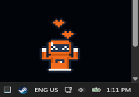
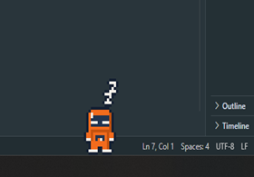
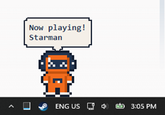

# Pocket_Astro

A tiny pixel astronaut that lives on top of your Windows taskbar.

He wanders around, sits down, falls asleep, and gets dizzy if you poke him too much. Every now and then he tells you to drink water. One Python file, and the only dependency is optional (it's for the music thing, see below).








## Running it

You need Windows and Python 3.9+. The core has no dependencies at all (tkinter comes with the normal Python installer), so the quickest way is:

```
python pocket_astro.py
```

That keeps a console window open, which is handy for seeing errors. Use `pythonw` instead of `python` to run him with no console.

### With uv

I use [uv](https://docs.astral.sh/uv/) for this repo. It sets up the environment for you, and it can even download Python if you don't have it.

```
winget install --id=astral-sh.uv -e
```

Then, from the repo folder:

```
uv run pocket_astro.py            # with a console, shows errors
uv run pythonw pocket_astro.py    # no console window
```

The first run creates a `.venv` folder next to the script. You never have to activate it.

## Now playing (optional)

If a song or video starts playing anywhere (Spotify, YouTube, YT Music, any browser tab), he puts on headphones for a couple of seconds and says what it is. It reads the same media info Windows shows in the volume flyout, and Windows tells him when the track changes, so there's no polling.

This is the one thing that needs extra packages. They're listed as the `music` extra in `pyproject.toml`, so with uv it's:

```
uv run --extra music pythonw pocket_astro.py
```

Add `--extra music` any time you run him. If you'd rather skip uv:

```
pip install winrt-runtime winrt-Windows.Media.Control winrt-Windows.Foundation winrt-Windows.Foundation.Collections winrt-Windows.Storage.Streams
```

Skip all of it and everything else still works, he just won't announce music. If it isn't working, run with `python` instead of `pythonw` and look for a line starting with `Astro:` in the console.

To turn it off, set `NOW_PLAYING = False` at the top of the script. `NOW_PLAYING_SHOW_ARTIST = True` adds the artist (on YouTube that's the channel name).

## Things you can do to him

- **Click**: he hops and throws hearts
- **Click 3 times fast**: spin jump
- **Click 6 times fast**: dizzy, stars everywhere
- **Drag him**: he panics. Let go and he falls back down. Throw him hard enough and he lands dizzy
- **Right-click**: menu with wave, spin, nap, wander on/off, speech on/off, quit

On his own he walks, sits, waves, blinks, and follows your mouse with his eyes. Leave the PC alone (no keyboard or mouse for about 3 minutes) and he'll sit down and nod off. He wakes up when you come back. Change `SLEEP_AFTER_IDLE_S` if that's too soon or too late.

## Talking

He says hi a few seconds after starting, gives a few reminders through the day (water, lunch, coffee at 6 PM, etc.), and does random small talk every 6 to 14 minutes. All of it is at the top of `pocket_astro.py`:

```python
USER_NAME = ""
CHAT_EVERY_MIN = (6, 14)
REMINDERS = [
    ("09:30", "Water time! Sip sip."),
    ("18:00", "It's 6 PM... coffee time?"),
    ...
]
CHAT = [...]
```

Times are 24-hour. Put your name in `USER_NAME` if you want him to use it. He isn't listening to anything, he just checks the clock every 20 seconds, so CPU use stays close to zero. To know if you're away he asks Windows how long it's been since your last input. That's just a number, never what you typed.

## Starting him automatically with Windows

Run him once with uv first (`uv sync`, or `uv sync --extra music` if you want the music thing) so the `.venv` folder exists. Then:

1. **Open the Startup folder:** press `Win+R`, type `shell:startup`, and press **Enter**.
2. **Create a shortcut:** right-click an empty area in the folder and select **New → Shortcut**.
3. **Set the target:** point it at the `pythonw.exe` inside the `.venv` and at the script, both in quotes:
   `"C:\path\to\Pocket_Astro\.venv\Scripts\pythonw.exe" "C:\path\to\Pocket_Astro\pocket_astro.py"`
   then click **Next**.
4. **Name it** `Pocket_Astro` (or anything you like) and click **Finish**.
5. **Set the working folder:** right-click the new shortcut, select **Properties**, set **Start in** to `C:\path\to\Pocket_Astro`, then click **Apply** and **OK**.

`pythonw` has no console window, so there's nothing to minimize. If you moved or deleted the `.venv`, the shortcut stops working.

Not using uv? Run `where pythonw` and use that path as the target instead (ignore anything inside `\WindowsApps\`, that's a Windows Store stub).

## How it works, roughly

- The sprite is a grid of letters in the code. Each letter is a color, and the outline is added automatically around whatever pixels exist
- The window is a borderless tkinter window with one color set as transparent, so only the astronaut's pixels are visible and clickable
- `ctypes` asks Windows where the taskbar is (so he stands on it), and checks whether the front window covers the whole monitor (so he hides during fullscreen games and videos)
- Behavior is a simple state machine: idle, walk, sit, sleep, wave, happy, spin, drag, fall, land, dizzy

## Known limits

- Windows only
- He only walks on the primary monitor
- If the taskbar is set to auto-hide, he stands at the bottom edge of the screen
- Built and tuned for Windows 11, haven't tried other versions much