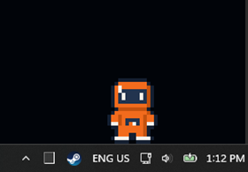
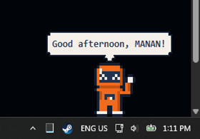
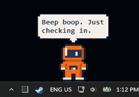

# Pocket_Astro

A tiny pixel astronaut that lives on top of your Windows taskbar.

He wanders around, sits down, falls asleep, and gets dizzy if you poke him too much. Every now and then he tells you to drink water. One Python file, no dependencies.








## Running it

You need Python 3.8+ on Windows. tkinter comes with the normal installer, so there's nothing to pip install.

```
pythonw pocket_astro.py
```

Use `python pocket_astro.py` instead if you want a console window to see errors.

To start him with Windows: press `Win+R`, type `shell:startup`, and put a shortcut to `pythonw.exe pocket_astro.py` in the folder that opens.

## Things you can do to him

- **Click**: he hops and throws hearts
- **Click 3 times fast**: spin jump
- **Click 6 times fast**: dizzy, stars everywhere
- **Drag him**: he panics. Let go and he falls back down. Throw him hard enough and he lands dizzy
- **Right-click**: menu with wave, spin, nap, wander on/off, speech on/off, quit

On his own he walks, sits, waves, blinks, and follows your mouse with his eyes. Leave the PC alone for a minute or so and he'll nod off.

## Talking

He says hi a few seconds after starting, gives a few reminders through the day (water, lunch, coffee at 6 PM, etc.), and does random small talk every 6 to 14 minutes. All of it is at the top of `pocket_astro.py`:

```python
USER_NAME = ""
CHAT_EVERY_MIN = (6, 14)
REMINDERS = [
    ("09:30", "Water time! Sip sip."),
    ("18:00", "It's 6 PM... coffee time?"),
    ...
]
CHAT = [...]
```

Times are 24-hour. Put your name in `USER_NAME` if you want him to use it. He isn't listening to anything, he just checks the clock every 20 seconds, so CPU use stays close to zero.

## How it works, roughly

- The sprite is a grid of letters in the code. Each letter is a color, and the outline is added automatically around whatever pixels exist
- The window is a borderless tkinter window with one color set as transparent, so only the astronaut's pixels are visible and clickable
- `ctypes` asks Windows where the taskbar is (so he stands on it), and checks whether the front window covers the whole monitor (so he hides during fullscreen games and videos)
- Behavior is a simple state machine: idle, walk, sit, sleep, wave, happy, spin, drag, fall, land, dizzy

## Known limits

- Windows only
- He only walks on the primary monitor
- If the taskbar is set to auto-hide, he stands at the bottom edge of the screen
- Built and tuned for Windows 11, haven't tried other versions much


## Starting him automatically with Windows

1. **Find your `pythonw.exe` path:** Open Command Prompt or PowerShell and run `where pythonw`. Copy the full path returned (ignore any path inside `\WindowsApps\pythonw.exe`, as that is a Windows Store stub). If you use `uv`, run `uv python find` and replace `python.exe` with `pythonw.exe` in that path.
2. **Open the Startup folder:** Press `Win+R`, type `shell:startup`, and press **Enter**.
3. **Create a shortcut:** Right-click an empty area in the folder and select **New → Shortcut**.
4. **Set the target:** In **Type the location of the item**, enter the full path to `pythonw.exe` followed by the full path to `pocket_astro.py` (wrapping both in quotes, e.g. `"C:\path\to\pythonw.exe" "C:\path\to\pocket_astro.py"`), then click **Next**.
5. **Name the shortcut:** Name it `Pocket_Astro` (or anything you like) and click **Finish**.
6. **Configure shortcut properties:** Right-click the new shortcut and select **Properties**:
* Set **Start in** to the folder containing `pocket_astro.py` (e.g., `"C:\path\to\Pocket_Astro"`).
* Change **Run** from *Normal window* to **Minimized**.
* Click **Apply**, then **OK**.